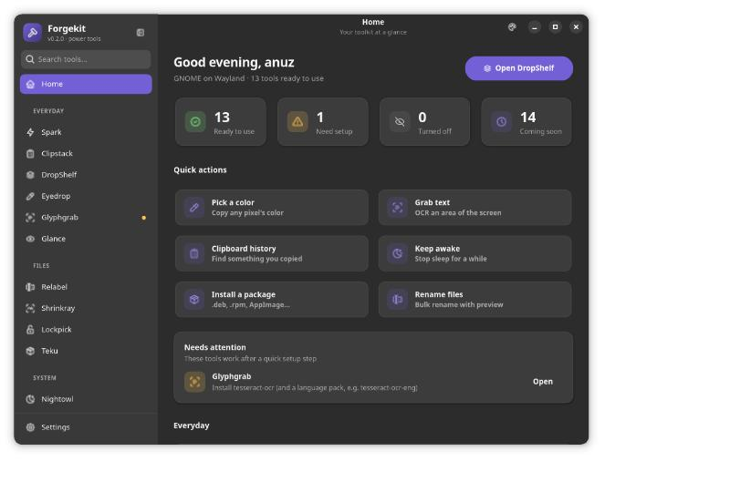
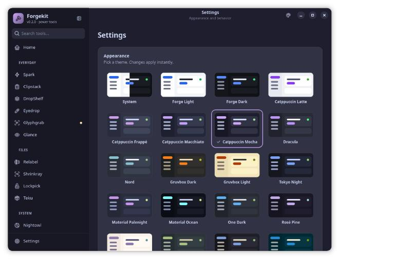
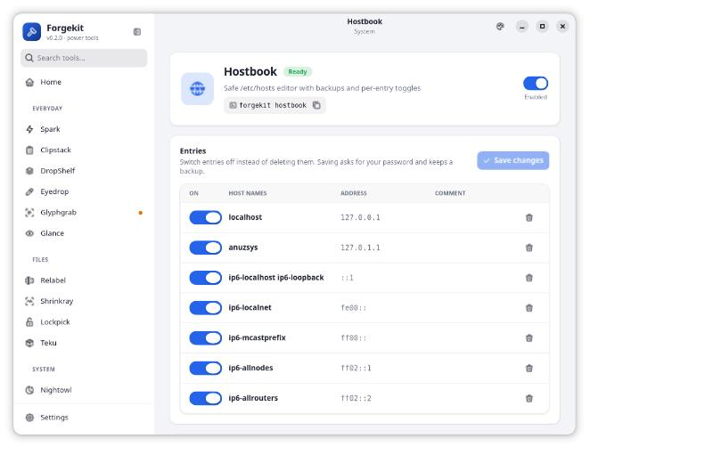
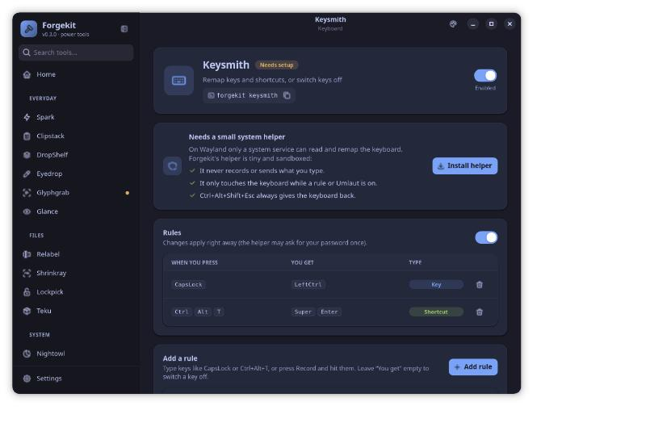
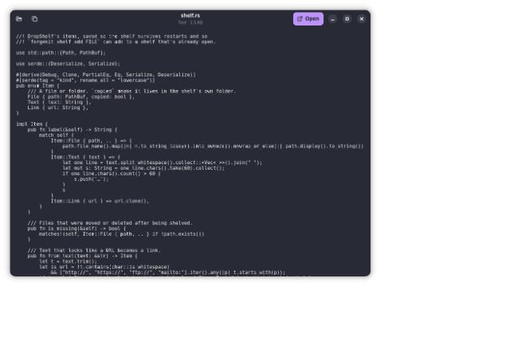

# Forgekit

All-in-one power tools for Linux. One app with a toggle per tool, every tool also on the command line, and honest detection: tools your desktop can't support are greyed out with a one-line reason.

Status: **v0.3 (Input)**. See [docs/PLAN.md](docs/PLAN.md) for the full catalog and roadmap.



| Themes | Tables & tools | Keysmith | Glance |
|---|---|---|---|
|  |  |  |  |

## Tools

| Tool | CLI | What it does |
|---|---|---|
| Spark | `forgekit spark 2+2`, `forgekit spark "10 km to mi"`, `forgekit spark firefox --run 1` | Apps, calculator, units, `install <file>`, web search |
| Clipstack | `forgekit clipstack [list\|copy ID\|show ID\|pin\|unpin\|delete\|clear\|private on\|off]` | Clipboard history for text and images, kept locally in SQLite |
| DropShelf | `forgekit shelf [FILE…]` | A small window that holds files, text and links while you switch apps; drag one or all out |
| Eyedrop | `forgekit eyedrop [-f hex\|rgb\|hsl]`, `--history` | Pick a screen color via the Screenshot portal |
| Glyphgrab | `forgekit glyphgrab [-l eng]`, `--image FILE` | Select an area, OCR it with Tesseract |
| Glance | `forgekit glance FILE` | Quick look at images, video, audio, text/code, PDFs, archives and folders (Space/Esc closes) |
| Relabel | `forgekit relabel *.jpg -f IMG_ -r trip_ [-x] [-t "{n:3}_{name}"] [--apply]` | Bulk rename, preview by default, handles swaps and collisions |
| Shrinkray | `forgekit shrinkray *.png -w 1280 -f webp` | Resize to fit and convert |
| Lockpick | `forgekit lockpick PATH [--close PID [--force]]` | Which processes hold a file or folder (fds, cwd, mmaps) |
| Teku | `forgekit teku detect\|install\|history\|uninstall` | Drives [Teku](https://github.com/anuzdhk/teku) |
| Nightowl | `forgekit nightowl [--for 1h30m] [--while PID]` | Blocks sleep (logind) and idle/blanking (Inhibit portal) |
| Dusk | `forgekit dusk [status\|light\|dark\|toggle\|times 07:00 19:30\|sun LAT LON\|manual]` | Light/dark switching, by hand or on a schedule (fixed times or sunrise/sunset) |
| Hostbook | `forgekit hostbook [list\|add IP NAME…\|on\|off\|remove NAME\|backups]` | Edits `/etc/hosts`, keeps untouched lines byte-for-byte, backs up before saving, writes through `pkexec` |
| Envy | `forgekit envy [list\|set KEY VALUE\|unset KEY] [--system]` | Your session's variables (`~/.config/environment.d`) or `/etc/environment` |
| Keysmith | `forgekit keysmith [list\|add capslock ctrl\|add ctrl+h backspace\|add insert none\|remove N\|on\|off]` | Remap keys (also while held, e.g. CapsLock → Ctrl), turn shortcuts into others, or switch keys off |
| Umlaut | `forgekit umlaut [status\|on\|off\|delay MS\|languages french,german]` | Hold a letter, tap Space or →/← to cycle é è ê ë…, release to keep. Shift for capitals |

`forgekit status` shows what this desktop supports. `forgekit enable|disable <tool>` toggles tools. Running `forgekit` with no arguments opens the app.

### How Clipstack reads the clipboard

| Session | Backend |
|---|---|
| X11 | XFixes |
| KDE Plasma, Sway, Hyprland, other wlroots | `wlr-data-control` |
| GNOME (Wayland) | XWayland's clipboard bridge, through the X11 backend |

Content marked by password managers is never stored. Private mode pauses recording. History lives in `~/.local/share/forgekit/clipstack/history.db` (folder mode 0700) and is never synced.

### The input helper (Keysmith, Umlaut)

On Wayland only a system service can read and remap the keyboard, so these two tools use `forgekit-helper`, a separate small program that runs as root:

- **Never records or sends keystrokes.** No key event crosses D-Bus; nothing is logged.
- **Idle unless needed.** It grabs keyboards only while a rule or Umlaut is switched on.
- **Asks before changes.** `SetConfig` is checked with polkit (`org.forgekit.helper.configure`, password cached a few minutes).
- **Sandboxed by systemd.** No network, no capabilities, read-only system, only `/dev/input` and `/dev/uinput`.
- **Emergency release.** **Ctrl+Alt+Shift+Esc** stops all remapping at once (`forgekit helper resume` turns it back on).
- Its crate depends only on `forgekit-keys` (pure logic, unit-tested) plus evdev and zbus, so it's small enough to review.

```bash
forgekit helper install     # one password prompt (pkexec)
forgekit helper status
forgekit helper uninstall
```

Packagers: `forgekit-helper --install --root "$pkgdir"` lays out the binary, systemd unit, D-Bus policy and polkit action without enabling anything.

Umlaut types accents with Ctrl+Shift+U (IBus's Unicode entry, on by default in GNOME). It turns off key repeat for letters that have accents, the same trade-off macOS makes. Hex digits are sent as US-layout keys.

## The app

- **Navigation by task:** Everyday, Files, System, Keyboard, Windows, Presenting, Maintenance. `Ctrl+K` searches tools; `Ctrl+,` opens Settings.
- **Home** shows what's ready, what needs a setup step (with the exact install command for your distro), and quick actions.
- **Themes:** System, Forge Light/Dark, Catppuccin (Latte, Frappé, Macchiato, Mocha), Dracula, Nord, Gruvbox (Dark, Light), Tokyo Night, Material (Palenight, Ocean), One Dark, Rosé Pine (and Dawn), Everforest, Kanagawa, Solarized (Dark, Light), and translucent Glass (Dark, Light) with adjustable opacity. Any theme can take an accent override. Switch from Settings or the palette button in the header bar.
- **Icons** are [Tabler Icons](https://tabler.io/icons) (MIT), converted to GTK's stroked symbolic format by `tools/import-tabler-icons.py`, so they follow the theme's colors.

```bash
forgekit-gtk              # main window
forgekit-gtk clipstack    # open on a tool's page
forgekit-gtk --shelf a.png b.pdf
forgekit-gtk --glance notes.md
```

## Layout

```
crates/forgekit-core   capability detection, catalog, settings, tool logic (no UI)
crates/forgekit-cli    the `forgekit` binary
crates/forgekitd       user daemon: Nightowl, Clipstack's clipboard watcher, Dusk's schedule
crates/forgekit-keys   key names, Keysmith rules, Umlaut tables, remapping engine (no I/O)
crates/forgekit-helper privileged input helper (evdev/uinput, system bus, polkit)
crates/forgekit-gtk    GTK4/libadwaita app
data/                  desktop entries, systemd user unit, D-Bus activation file
tools/                 icon import script
```

## Building

```bash
cargo build --release
```

That builds the core, CLI, daemon and input helper. The app needs GTK ≥ 4.20 (for stroked symbolic icons), libadwaita ≥ 1.5 and their development packages:

```bash
sudo apt install libgtk-4-dev libadwaita-1-dev
```

```bash
cargo build --release -p forgekit-gtk
```

Optional runtime tools: `tesseract-ocr` (Glyphgrab), `wl-clipboard` or `xclip` (copying from the CLI), `poppler-utils` (PDF previews in Glance), `teku`.

## Daemon API

Session bus name `org.forgekit.Daemon`.

- `/org/forgekit/Daemon`, `org.forgekit.Daemon1`: `Capabilities() → s`, `Tools() → s` (JSON), `NightowlStart(reason s, seconds u)` (0 = until stopped), `NightowlStop()`. Properties `Version`, `NightowlActive`, `NightowlReason`.
- `/org/forgekit/Clipstack`, `org.forgekit.Clipstack1`: `Copy(id x)`, `Add(mime s, data ay)`, `Reload()`. Properties `Backend`, `Private` (read/write). Signal `Changed`.

```bash
busctl --user call org.forgekit.Daemon /org/forgekit/Clipstack org.forgekit.Clipstack1 Copy x 42
```

## License

GPL-3.0-or-later. Tabler Icons are MIT ([license](crates/forgekit-gtk/data/icons/TABLER-LICENSE)).
